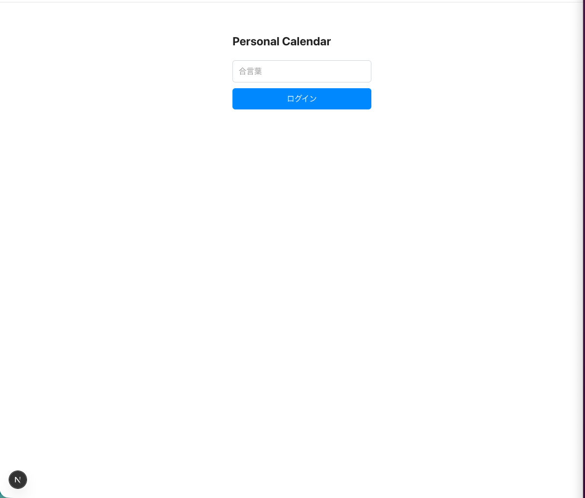
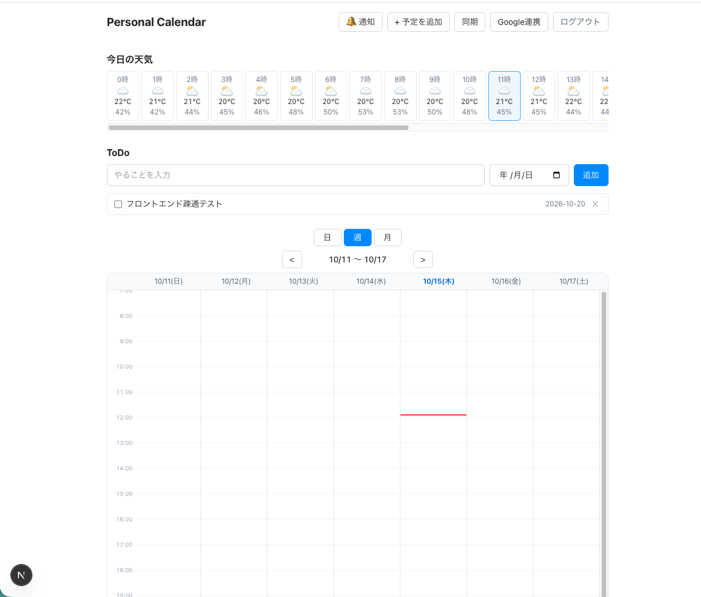
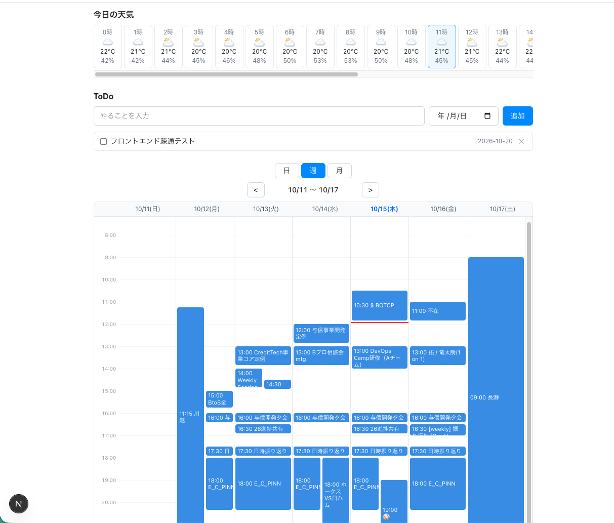
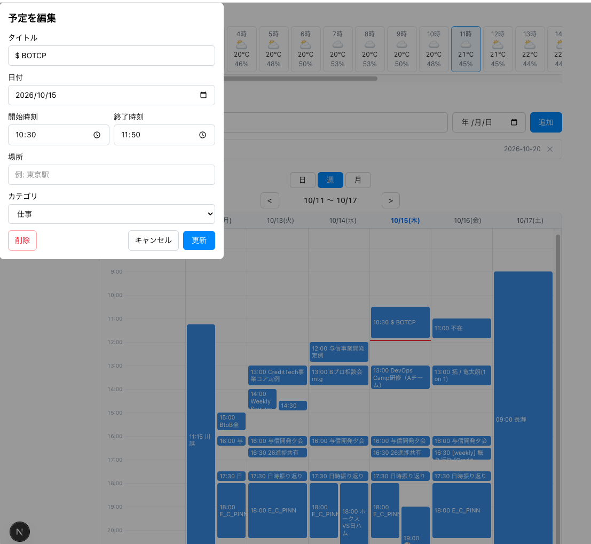
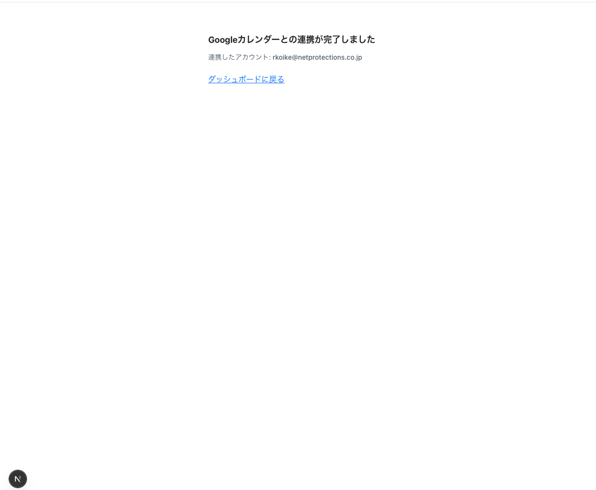

# フロントエンド実装レポート(Personal Calendar)

## 概要

### 構成

Step 4・5で設計した4画面を、Next.js(TypeScript)で実装した。バックエンドは既存のGo製APIをそのまま使い、今回の実装に伴って画面を返す処理だけを取り除いている。

- フレームワーク: **Next.js 16(App Router)/ React 19 / TypeScript**
- スタイリング: **Tailwind CSS v4**
- 状態管理: ライブラリは使わず、Reactの`useState`のみ
- バックエンド連携: ブラウザから同一オリジンの`/api/*`を`fetch`で呼び、Next.jsの`rewrites`がGoへ転送する
- 静的解析: TypeScriptの型チェック(`tsc --noEmit`)、ESLint(`eslint-config-next`)

```
personal-calendar/
  cmd/server/              Goのエントリーポイント
  internal/                Goのバックエンド(API・認証・外部連携)
  frontend/                ここから下が今回実装したフロントエンド
    src/
      app/
        layout.tsx         共通レイアウト(メタ情報・PWA設定)
        page.tsx           SCR-002 ダッシュボード画面
        login/page.tsx     SCR-001 ログイン画面
        google-linked/     SCR-004 Google連携完了画面
      components/
        CalendarSection.tsx  日/週/月のカレンダー表示
        EventDialog.tsx      SCR-003 予定追加・編集ダイアログ
        TodoSection.tsx      ToDoの一覧・追加・完了・削除
        WeatherSection.tsx   今日の時間ごとの天気
        NotifyButton.tsx     プッシュ通知の購読切り替え
      lib/
        api.ts             バックエンドAPIの呼び出しと型定義
        calendar.ts        カレンダー表示の計算(純粋関数)
      proxy.ts             未ログイン時のログイン画面への転送
    public/                Service Worker・アイコン・manifest
```

### 工夫した点

#### 1. バックエンドを変更せずにCookie認証を成立させた

フロントエンドとバックエンドでサーバーが分かれると、ブラウザから見て別サイトへのリクエストになるため、通常はCORSの設定とCookieの`SameSite`属性の変更がバックエンド側に必要になる。

今回はNext.jsの`rewrites`で`/api/*`をGoへ転送する構成にした。ブラウザはNext.jsだけと通信するため、セッションCookieがファーストパーティのまま扱える。結果として、**認証まわりでGo側に加えた変更はゼロ**になった。

```ts
// next.config.ts
async rewrites() {
  return [
    { source: "/api/login", destination: `${backendOrigin}/login` },
    { source: "/api/logout", destination: `${backendOrigin}/logout` },
    { source: "/api/:path*", destination: `${backendOrigin}/api/:path*` },
    { source: "/auth/google/:path*", destination: `${backendOrigin}/auth/google/:path*` },
  ];
}
```

#### 2. 未ログインの検知を2か所に分けた

フロントエンドに「ログイン済みか」という状態変数は持たせていない。持たせると、その変数とバックエンドの実際の判定が食い違い、画面は開けるのにAPIが全て失敗する、といったずれが起こり得るためである。

代わりに、役割を分けた2か所で捌いている。

- **画面を開くとき**: `proxy.ts`がセッションCookieの有無だけを見て、無ければログイン画面へ転送する。これは無駄な往復を減らすための前段で、認証の判断ではない
- **APIを呼ぶとき**: Goが未認証のリクエストに返す302を`fetch`の`redirect: "manual"`で捉え、`UnauthorizedError`としてログイン画面へ移動させる

認証の判断自体はGoが毎回DBと照合して行い、フロントエンドはその結果に従うだけという関係を保っている。

#### 3. カレンダーの計算をコンポーネントから切り離した

予定の重なりを横に並べる列の割り当て、グリッド上の座標計算、月表示の42マスの生成といった処理を、`lib/calendar.ts`の純粋関数としてまとめた。表示部分(`CalendarSection.tsx`)はその結果を描画するだけになっている。

この分離により、計算部分は外部依存もDOM操作も持たないため、今後テストを追加する際に手を付けやすい形になった。

#### 4. 外部への書き込みとアプリ内の更新を分けた

予定の更新では、Googleカレンダーへの書き込み(`PUT /api/events/{id}`)が主催者でないなどの理由で失敗しても、アプリ内だけの色分け更新(`PUT /api/events/{id}/category`)は必ず実行する。これにより「件名は変更できないが、色分けだけは反映される」という挙動になり、片方の失敗がもう片方を巻き込まない。

Step 2のAPI設計でエンドポイントを分離した意図を、画面側の処理でも維持している。

## ソースコード

GitHubリポジトリ: https://github.com/rkoike-cpu/Private_calendar (Private)

フロントエンドは`frontend/`配下。設計書は`docs/`配下に置いている。

- [画面設計書(画面一覧・画面遷移図)](https://github.com/rkoike-cpu/Private_calendar/blob/main/docs/screen-design.md)
- [画面レイアウト・イベント設計書](https://github.com/rkoike-cpu/Private_calendar/blob/main/docs/screen-layout-event-design.md)

## 画面の動作確認

### SCR-001 ログイン画面



合言葉を入力してログインする。誤った合言葉を入れた場合は、画面を切り替えずに入力欄の下へ「パスワードが違います」を表示する。

### SCR-002 ダッシュボード画面



同期ボタンを押す前の状態。天気とToDoは画面を開いた時点で取得するため表示されているが、予定はまだ取得していないためカレンダーは空になる。これは設計上の意図通りの状態で、外部APIへの通信を毎回走らせないための判断による。



同期ボタンを押すと、Googleカレンダーから取得した予定が表示される。

上から「ヘッダー → ステータス表示 → 天気 → ToDo → カレンダー」の縦1列で配置している。

- ヘッダーのボタン: 通知 / + 予定を追加 / 同期 / Google連携 / ログアウト
- 天気: 今日の時間ごとの気温・湿度を横スクロールで表示し、現在時刻の枠を強調する
- ToDo: 未完了を上、完了済みを下に並べる。完了済みは取り消し線で表示する
- カレンダー: 日/週/月を切り替えられる。予定はカテゴリ別に色分けし、現在時刻に赤い線を引く

### SCR-003 予定追加・編集ダイアログ



「+ 予定を追加」で空の状態、カレンダー上の予定をクリックで内容が入った状態で開く。削除ボタンは編集時のみ表示する。

### SCR-004 Google連携完了画面



Googleの同意画面から戻ったあとに表示する。連携したアカウントのメールアドレスを必ず表示し、意図しないアカウントで連携した場合に気づけるようにしている。

### 操作の流れ

ログイン → 同期 → 予定の確認・編集 → ToDoの追加 → ログアウト、までを一連の操作として確認した。

## 静的解析・自動テスト

### フロントエンド

#### 型チェック(TypeScript)

```
$ npx tsc --noEmit
$ echo $?
0
```

エラーなし(出力なしで正常終了)。

#### ESLint

```
$ npm run lint

> frontend@0.1.0 lint
> eslint
```

違反なし(出力なしで正常終了)。

#### 本番ビルド

```
$ npm run build

▲ Next.js 16.4.1 (Turbopack)
✓ Running next.config.ts took 11ms

  Creating an optimized production build ...
✓ Compiled successfully in 1330ms
  Running TypeScript ...
  Finished TypeScript in 808ms ...
✓ Generating static pages using 7 workers (6/6) in 231ms
  Finalizing page optimization ...

Route (app)
┌ ○ /
├ ○ /_not-found
├ ƒ /google-linked
└ ○ /login

ƒ Proxy (Middleware)

○  (Static)   prerendered as static content
ƒ  (Dynamic)  server-rendered on demand
```

### バックエンド

画面を返す処理を削除し、ログアウトのエンドポイントを追加したため、改めて実行した。

```
$ go test ./cmd/... ./internal/...

ok  	personal-calendar/internal/auth	0.497s
ok  	personal-calendar/internal/weather	0.538s
```

```
$ golangci-lint run ./cmd/... ./internal/...

0 issues.
```

今回、ログアウトの追加にあわせて次の2つのテストを追加した。

- `TestLogoutHandler_ClearsSessionAndCookie`: セッションがDBから削除され、Cookieが失効すること
- `TestRequireAuth_RejectsSessionAfterLogout`: ログアウト後に古いCookieを送っても、保護されたハンドラに到達しないこと

画面の自動テスト(JestやReact Testing Library)は今回の範囲に含めていない。品質の担保は型チェックとESLintで行い、テストは今後の課題としている。

## 設計からの変更点

Step 4・5の設計から変えた点は4つ。いずれも設計書に反映済み。

| 変更点 | 理由 |
|---|---|
| SCR-004をフロントエンド側の画面にした | バックエンドを「JSONを返すAPI」に統一したため。コールバック処理を終えたあと、メールアドレスを添えてフロントエンドの画面へ転送する形にした |
| 未ログイン時の検知を2段構えにした | 画面を返すのがフロントエンドになったため、画面を開く時点の確認はフロントエンド側に移った。「認証の判断はバックエンドに置く」という意図は維持している |
| セッション切れの検知を範囲に含めた | 当初は対象外としていたが、APIの応答から未認証を見分ける仕組みを実装の中で用意できたため |
| ログアウトとGoogle連携の導線を追加した | ログインからの流れをいつでも確認できるようにするため。あわせて、URL直打ちだったGoogle連携もヘッダーのリンクから開始できるようにした |

## まとめ

### 実装中に苦労したこと

- **会社ネットワークがDBのポートを遮断していた**: ローカルからSupabaseへ接続しようとしたが、5432・6543のどちらもタイムアウトした。HTTPS(443)は通ることを確認し、ポート単位の遮断だと切り分けたうえで、ローカルにPostgreSQLを立てて接続先を切り替えた。結果として、ローカルでの動作確認が本番のデータを汚さない構成になった
- **Next.js 16の仕様変更**: `create-next-app`が生成した設定に`cacheComponents`が含まれていたが、これを有効にすると`new Date()`のような処理がビルドエラーになる。現在時刻を扱うカレンダーアプリとは相性が悪いため外した。他にも`middleware.ts`が`proxy.ts`に改名されているなど、知っている書き方が通用しない箇所があり、同梱ドキュメントを確認しながら進める必要があった
- **ESLintが指摘した、エフェクト内での状態更新**: ダイアログを開くたびに入力欄を初期化する処理を`useEffect`で書いたところ、「エフェクト内で同期的に状態を更新している」と指摘された。開いている間だけダイアログを描画し、`key`を変えて開き直す構造にすることで、初期化の処理自体を不要にした

### 工夫したこと

- **バックエンドへの変更を最小限にした**: `rewrites`でプロキシする構成にしたことで、CORSやCookieの属性変更が不要になった。今回Goに加えた変更は、画面を返す処理の削除と、ログアウトのエンドポイント追加だけで済んでいる
- **設計書の判断を実装でも維持した**: 「外部への書き込みとアプリ内の更新を分ける」「認証の判断はバックエンドに置く」といった設計時の判断を、そのまま実装の構造に反映させた。設計書を読めばコードの構造が分かる状態を保っている
- **設計と実装がずれた箇所は、設計書側を更新した**: ずれたまま放置せず、変更点と理由を設計書に明記した。どの判断を、なぜ変えたのかが後から追える

### 今後の課題

バックエンドから画面を返す処理を削除したため、フロントエンドをデプロイするまでは本番環境(Render)で画面を表示できない。Step 6の目標は「ローカルで動く状態」までのため、本番への反映はStep 7以降で対応する。

デプロイ時には、フロントエンドとバックエンドが別オリジンになるため、ローカルではプロキシで回避していた次の対応が必要になる。

| 対応 | 内容 |
|---|---|
| CORSの設定 | Goが許可するオリジンと`Access-Control-Allow-Credentials`を返すようにする。プリフライト(`OPTIONS`)への応答も必要 |
| Cookieの属性変更 | `SameSite=Lax`では別サイト扱いで送られないため、`SameSite=None; Secure`に変える |
| fetchの変更 | フロントエンドの`fetch`に`credentials: "include"`を追加する |
| OAuthのリダイレクトURI | Google Cloud Consoleに本番フロントエンドのURLを追加する |
| 環境変数 | フロントエンドに`BACKEND_ORIGIN`、Goに許可するオリジンの設定を追加する |

### 学んだこと

- **サーバーが分かれると認証が途端に難しくなる**: 1つのサーバーが画面もAPIも返していたときは、Cookieについて何も考えずに済んでいた。サーバーを分けた瞬間にCORS・`SameSite`・`credentials`といった考慮が一度に増える。今回はプロキシを挟むことで回避できたが、「同一オリジンかどうか」が認証の難易度を大きく左右すると実感した
- **フレームワークのバージョン差は、調べ方から変わる**: Next.js 16は記憶にある書き方がそのまま通らない箇所が多く、`node_modules`内の同梱ドキュメントを読んでから書く必要があった。自分の知識を前提に書き始めるのではなく、まず今使っているバージョンの仕様を確認する、という順序の大切さを学んだ
- **計算とDOM操作を分けておくと移植しやすい**: 元のバニラJS版は、カレンダーの座標計算とDOM操作が同じ関数の中で混ざっていた。今回はまず計算部分を純粋関数として切り出し、そのあとで表示部分を書いた。この順序にしたことで、移植の作業が「計算の移し替え」と「表示の書き直し」に分かれ、片方ずつ確認しながら進められた
