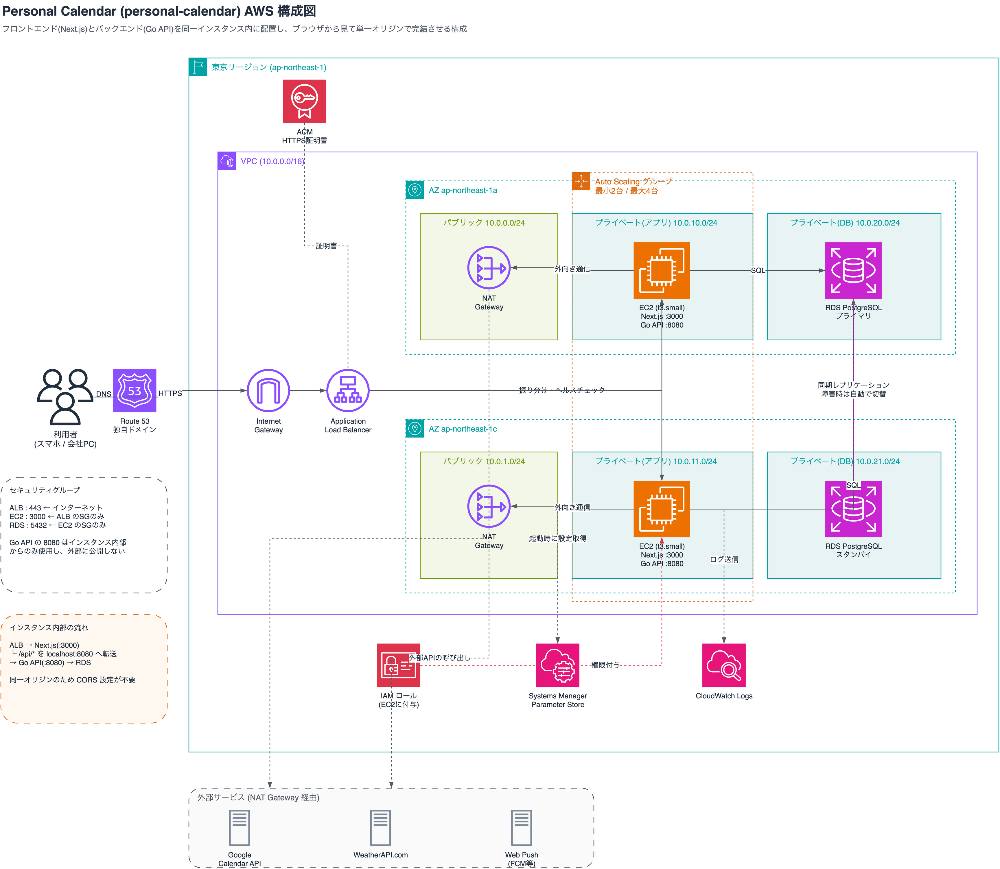

# インフラ構成設計書(Personal Calendar)

Step 3で実装したバックエンド(Go)と、Step 6で実装したフロントエンド(Next.js)を、AWS上で稼働させるための構成を設計する。本書は構成の設計までを対象とし、構築は次のStepで行う。

## 概要

### 構成の特徴

**1台のEC2インスタンスの中で、フロントエンドとバックエンドを並べて動かす**構成にした。ALBとAuto Scalingで同じ構成のインスタンスを2つのアベイラビリティゾーン(AZ)に1台ずつ配置し、可用性を確保する。HTTPSはALBの前に置いたCloudFrontで終端する。

この配置を選んだ最大の理由は、**ブラウザから見たときに単一のドメインで完結する**ことにある。Step 6では、ブラウザがNext.jsの`/api/*`を呼び、Next.jsがGoへ転送する形にしている。この関係をそのままEC2の中に持ち込めば、ローカルで動いている構成を変えずにクラウドへ載せられる。

```
ブラウザ → CloudFront → ALB → EC2 ─┬─ Next.js (:3000) ← ALBはここへ転送
 (HTTPS)                (HTTP)       └─ Go API (:8080) ← Next.jsが内部で転送
```

設計にあたっては、**要件を満たすために必要なものだけを置く**ことを方針とした。各部品について「何のために必要か」を確認し、目的が別の手段で満たせるものは省いている。

### 採用したサービス

| 層 | サービス | 用途 |
|---|---|---|
| 配信 | CloudFront | HTTPS終端(`*.cloudfront.net`の証明書を利用) |
| 負荷分散 | ALB | 複数インスタンスへの振り分けとヘルスチェック |
| アプリ | EC2 + Auto Scaling | Next.jsとGoの実行、故障したインスタンスの自動入れ替え |
| データ | RDS for PostgreSQL(マルチAZ) | 永続化 |
| ネットワーク | VPC / サブネット / Internet Gateway | 通信経路の制御 |
| 権限 | IAM(インスタンスロール) | EC2からAWSサービスへのアクセス |
| 設定 | Systems Manager パラメータストア | 接続情報や鍵の保管 |
| 監視 | CloudWatch Logs | アプリケーションログの集約 |

### 初版からの変更

初版の構成を「必要なものだけを置く」方針で見直し、次の通り変更した。各判断の理由は選定理由の節に記す。

| 変更 | 内容 |
|---|---|
| 削除 | NAT Gateway(AZごとに2つ) |
| 削除 | プライベート(アプリ)サブネット。EC2はパブリックサブネットへ移した |
| 削除 | Route 53・ACM(独自ドメインを持たない) |
| 追加 | CloudFront(独自ドメインなしでHTTPSを実現するため) |
| 変更 | Auto Scalingを「最小2台 / 最大4台」から「2台固定」へ |

## インフラ構成図



| ファイル | 用途 |
|---|---|
| [`images/infra-architecture.png`](./images/infra-architecture.png) | 提出用の画像 |
| [`images/infra-architecture.svg`](./images/infra-architecture.svg) | 拡大しても劣化しない版 |
| [`infra-architecture.drawio`](./infra-architecture.drawio) | 編集用(draw.io / app.diagrams.net で開く) |

### 通信の制御(セキュリティグループ)

各層は、直前の層からの通信だけを受け付ける。

| 対象 | 受け付ける通信 | 送信元 |
|---|---|---|
| ALB | 80 (HTTP) | CloudFrontのみ(AWS管理のプレフィックスリスト`com.amazonaws.global.cloudfront.origin-facing`) |
| EC2 | 3000 | ALBのセキュリティグループのみ |
| RDS | 5432 | EC2のセキュリティグループのみ |

Goの8080番はインスタンスの内部からのみ使うため、外部には一切開放しない。EC2はパブリックサブネットに置いてパブリックIPを持つが、上記以外の内向き通信はセキュリティグループですべて拒否する。RDSはインターネットへの経路を持たないプライベートサブネットに置く。

## 選定理由

各サービスについて、どの選択肢と比較してなぜこれを選んだのかを記す。

### CloudFront — HTTPS終端

| 比較した選択肢 | 採否 |
|---|---|
| ALBが自動で払い出すドメイン名に、HTTPのままアクセスする | **成立しない** |
| 独自ドメインを取得し、Route 53とACMでALBをHTTPS化する | 不採用 |
| **ALBの前にCloudFrontを置き、`*.cloudfront.net`でHTTPSを終端する** | **採用** |

HTTPのままという選択肢は、このアプリでは成立しない。GoogleのOAuthはリダイレクト先に`https://`を要求し、セッションCookieの`Secure`属性はHTTPSでなければ機能せず、プッシュ通知に必要なService WorkerもHTTPS上でしか登録できないためである。

一方、ALBをそのままHTTPS化するには証明書が要る。ACMは自分が管理するドメインにしか証明書を発行できず、ALBが払い出す`*.elb.amazonaws.com`の名前では発行できない。つまり**ALBだけでHTTPSを実現するには、独自ドメインの取得が前提になる**。

CloudFrontは、払い出される`*.cloudfront.net`の名前にAWSの証明書があらかじめ用意されており、ドメインを持たずにHTTPSで公開できる。今回は独自ドメインを持たない方針のため、こちらを採った。費用面でも、独自ドメイン案はドメインの更新費とRoute 53のホストゾーンで月$1.5〜2程度かかるのに対し、CloudFrontは個人利用の通信量であれば無料枠に収まる。ただし差は小さく、**決め手はドメインの取得と管理が不要になる点**である。

このアプリは画面もAPIも利用者ごとの内容を返すため、CloudFrontはキャッシュのためではなく、HTTPSの入口としてだけ使う。設定は次の通りとする。

| 設定 | 値 | 理由 |
|---|---|---|
| キャッシュポリシー | CachingDisabled | 利用者ごとの内容を返すため、キャッシュさせない |
| オリジンリクエストポリシー | AllViewer | Cookie・クエリ・Hostヘッダーをすべてアプリへ渡す。渡さないとログインが成立しない |
| ビューアープロトコルポリシー | Redirect HTTP to HTTPS | HTTPでのアクセスをHTTPSへ転送する |
| 許可するメソッド | GET, HEAD, OPTIONS, PUT, POST, PATCH, DELETE | 合言葉ログインや予定の更新でPOST等を使う |
| オリジンへの通信 | HTTP(80) | ALBに証明書を持たないため |

### ALB — 振り分けとヘルスチェック

| 比較した選択肢 | 採否 |
|---|---|
| ロードバランサを置かず、EC2へ直接アクセスさせる | **要件を満たさない** |
| NLB(ネットワークロードバランサ) | 不採用(要件自体は満たせる) |
| **ALB(アプリケーションロードバランサ)** | **採用** |

ロードバランサを置かない案は、「一部のサーバに障害が起きても応答できる」という要件を満たせないため除外した。振り分け先を切り替える仕組みがなければ、落ちたインスタンスへアクセスが届き続ける。

**NLBとの比較は、どちらでも要件を満たせる。** NLBにもヘルスチェックがあり、異常なインスタンスを切り離す動作は同じで、HTTPでの確認にも対応している。そのうえでALBを選んだ理由は次の2点である。

- **HTTPで完結するアプリであり、ALBのほうが素直に扱える**。利用者のIPを`X-Forwarded-For`で後段へ渡す処理や、HTTPのパスを使ったヘルスチェックなど、HTTPを前提とした機能がそのまま使える
- **将来の選択肢が広い**。フロントエンドとバックエンドを別インスタンスに分けたくなった場合、ALBならパスによる振り分け(`/api/*`とそれ以外)で対応できる

逆にNLBが優れる点(処理が軽い、固定IPを持てる、HTTP以外の通信を扱える)は、利用者が1人でHTTPのみ、固定IPも不要な今回の構成では一つも活きない。**差が出ない以上、HTTPアプリにとって標準的な選択であるALBにした**、というのが実際のところである。

なおHTTPSの終端はCloudFrontが担うため、ALBはHTTP(80)で受け付ける。ALBへ届く通信はセキュリティグループでCloudFrontからのものに限定し、ALBのアドレスへ直接アクセスされても応答しないようにする。

### EC2 + Auto Scaling — アプリケーションの実行

| 比較した選択肢 | 採否 |
|---|---|
| EC2を1台だけ固定で動かす | **要件を満たさない** |
| ECS / EKS(コンテナ基盤)で動かす | 不採用 |
| EC2 + Auto Scaling(最小2台 / 最大4台、CPU使用率で増減) | 不採用 |
| **EC2 + Auto Scaling(2台固定)** | **採用** |

1台構成は、そのインスタンスが落ちた瞬間にサービスが止まるため、可用性の要件を満たせない。2台を別々のAZに置くことで、インスタンス単位の障害にもAZ単位の障害にも耐えられる。

コンテナ基盤との比較では、**得られる利点が現時点の規模に見合わない**と判断した。このアプリはGoのバイナリ1つとNode.jsのプロセス1つで動くため、コンテナ化で解決される問題(環境差異、依存関係の衝突)がそもそも起きにくい。一方で、クラスタやタスク定義といった学ぶべき構成要素は確実に増える。まずEC2で構成を理解することを優先した。

台数を負荷に応じて増減させる設定は採らなかった。利用者は自分1人で、t3.small 2台のCPUが逼迫する場面がないため、増やす仕組みを置いても動く機会がない。**この構成でAuto Scalingに求めるのは、台数を増やすことではなく、故障したインスタンスを自動で入れ替えること**である。最小・最大・希望台数をすべて2とし、ヘルスチェックの種類を「ELB」にすることで、ALBが異常と判断したインスタンスを自動で作り直す。片方のAZが停止した場合は、残ったAZに代わりのインスタンスを起動する。

### RDS for PostgreSQL(マルチAZ) — データの永続化

| 比較した選択肢 | 採否 |
|---|---|
| EC2にPostgreSQLを自前で立てる | 不採用 |
| RDSのシングルAZ構成 | 不採用 |
| **RDSのマルチAZ構成** | **採用** |

自前で立てる案は、バックアップの取得・パッチの適用・障害時の切り替えをすべて自分で作り込む必要がある。これらは本来のアプリ開発とは別の作業であり、マネージドサービスに任せたほうが確実性が高い。

シングルAZとの比較では、**アプリ側だけ冗長にしてもDBが単一障害点として残る**点が決め手になった。EC2を2台にしてもDBが1台構成なら、そこが落ちた時点でサービスは止まる。見たいときに予定が見られない状態は、このアプリにとって最も避けたい障害である。マルチAZでは別のAZに待機系が自動で用意され、障害時には自動で切り替わる。

構成を見直す過程でも、ここは費用が大きい部分として削減を検討した。しかし可用性の要件に直結するため、**省かない**と判断した。

なお現在のアプリはPostgreSQLを使っているため、接続先を変えるだけで移行できる。

### VPC・サブネット — 通信経路の制御

| 比較した選択肢 | 採否 |
|---|---|
| EC2・RDSをプライベートサブネットに置き、NAT Gatewayで外へ出る | 不採用 |
| EC2・RDSをどちらもパブリックサブネットに置く | 不採用 |
| **EC2はパブリックサブネット、RDSはプライベートサブネットに置く** | **採用** |

| 層 | 配置するもの | インターネットへの経路 | インターネットからの到達 |
|---|---|---|---|
| パブリック | ALB、EC2 | あり(Internet Gateway) | ALBはCloudFrontからのみ、EC2はALBからのみ(セキュリティグループで制限) |
| プライベート(DB) | RDS | なし | 不可 |

**EC2の配置。** このアプリのEC2は外部への通信を常に行う。Google Calendar APIでの予定の取得と更新、Google OAuthのトークン更新、WeatherAPI.comでの天気取得、プッシュ通知の送信、パラメータストアとCloudWatch Logsへの接続である。特にリマインダーは1分ごとにGoogleへ問い合わせる。

EC2をプライベートサブネットに置く場合、これらの通信のためにNAT Gatewayが必要になる。**NAT Gatewayが必要になるのは「外へ出る通信がある」からではなく、「プライベートサブネットに置いたまま外へ出たい」から**である。NAT Gatewayは通信がなくても1つあたり月$45程度かかり、AZごとに置けば月$90程度になる。

EC2をパブリックサブネットに置けば、Internet Gatewayから直接外へ出られるため、NAT Gatewayは要らない。インターネットからEC2への接続は、セキュリティグループで「ALBからの3000番のみ」に絞ることで引き続き防げる。失うのは、セキュリティグループの設定を誤った場合にネットワークの経路側でも止める、という二重の防御である。個人利用のアプリに対して月$90の費用は見合わないと判断し、この防御はセキュリティグループに一本化した。

この変更には可用性の面での利点もある。初版では、NAT Gatewayを1つに減らすと「そのAZが落ちたとき、もう片方のAZのインスタンスが予定を取得できなくなる」ことが課題だった。各EC2がInternet Gatewayから直接外へ出る構成では、**外向きの通信が他のAZに依存しない**ため、この課題自体がなくなる。

**RDSの配置。** RDSは外部と通信する必要がなく、パブリックサブネットに置く利点がない。一方でサブネットの追加に費用はかからない。インターネットへの経路を持たないサブネットに置けば、仮に「パブリックアクセス」の設定やセキュリティグループを誤っても、外部からは到達できない。**費用をかけずに防御を一段増やせる**ため、DBは引き続きプライベートサブネットに置く。RDSのDBサブネットグループには2つ以上のAZのサブネットが必要なため、AZごとに1つずつ用意する。

### IAM(インスタンスロール) — 権限の管理

| 比較した選択肢 | 採否 |
|---|---|
| アクセスキーをインスタンス内のファイルに置く | 不採用 |
| **インスタンスロールを割り当てる** | **採用** |

アクセスキーをファイルに置くと、そのキーがインスタンスのイメージや設定ファイルに混入する経路が生まれる。Auto Scalingではインスタンスのイメージを複製して起動するため、この混入は全台に広がる。

ロールであれば、必要な権限が起動時に自動で付与され、認証情報の有効期限も自動で更新される。付与する権限は、パラメータストアの読み取り・CloudWatch Logsへの書き込み・Session Managerでの接続の3つに絞る。

### Systems Manager パラメータストア — 設定値の保管

| 比較した選択肢 | 採否 |
|---|---|
| AMIや設定ファイルに値を埋め込む | 不採用 |
| Secrets Manager | 不採用 |
| **パラメータストア(SecureString)** | **採用** |

Auto Scalingではインスタンスが自動で作られるため、起動したインスタンスが自力で設定値を取得できる必要がある。AMIに埋め込む案は、値を変更するたびにAMIを作り直すことになり、かつ値がイメージに残り続ける。

Secrets Managerとの比較では、こちらが持つ**鍵の自動ローテーション機能を今回は使わない**点が判断材料になった。その機能のぶん費用が発生するため、無料の範囲で使えるパラメータストアを選んだ。

保管する対象は、DBの接続情報・合言葉・WeatherAPIのキー・VAPIDの鍵・Google OAuthの認証情報である。

### CloudWatch Logs — ログの集約

| 比較した選択肢 | 採否 |
|---|---|
| インスタンス内のファイルにログを残す | 不採用 |
| **CloudWatch Logsへ送る** | **採用** |

インスタンスは自動で作られ、自動で破棄される。インスタンス内にログを置くと、**障害でインスタンスが入れ替わった際に、原因究明に必要なログごと消える**。最も知りたい場面で最も手に入らない、という状態になる。

外部に送っておくことで、インスタンスの生死と切り離してログを追える。Step 3でエラーをすべてログに残す方針にした判断が、ここで活きる。

## この構成のリスク

### 障害を検知するまでの間はエラーが返る

ALBのヘルスチェックは一定間隔で行うため、インスタンスが壊れてから切り離されるまでに時間差がある。標準的な設定(30秒間隔・2回連続で異常と判定)だと、最長で約1分のあいだ、壊れたインスタンスへ振り分けが続く。

ただし壊れ方によって影響が異なる。プロセスが完全に停止した場合はTCP接続自体が成立しないため、ALBが別のインスタンスへ接続を試み、利用者にエラーは届かない。問題になるのは**プロセスは生きているが500を返す状態**で、このときALBは応答があったものとして扱い、その500をそのまま返す。

要件は「一部のサーバに障害が起きても継続的に応答できる」ことであり、個々のリクエストが1件もエラーにならないことまでは求めていない。間隔を短くすれば検知は速くなるが、確認用の通信が増え、一時的に応答が遅れただけのインスタンスを誤って切り離す可能性も上がる。今回は個人利用で数十秒のエラーが実害につながらないため、標準的な設定のままとする。

### ヘルスチェック用のエンドポイントが未実装

現在のアプリには、死活確認のための専用パスがない。認証不要で200を返す`/login`で代用できるが、これはNext.jsだけで応答できるため、**Goが停止していてもヘルスチェックは通ってしまう**。

構築時(次のStep)に、Next.jsとGoの両方が応答できることを確認する専用のエンドポイントを追加する。

### EC2を守るのがセキュリティグループだけになる

EC2をパブリックサブネットに置いたため、インターネットからの接続を止めているのはセキュリティグループのみである。誤って`0.0.0.0/0`からの通信を許可すると、EC2がそのままインターネットに公開される。

対策として、EC2のセキュリティグループには送信元にALBのセキュリティグループを指定するルール以外を追加しない。SSHの22番も開けず、接続はSession Manager経由に限る。

### CloudFrontとALBの間はHTTPになる

ALBに証明書を持たないため、CloudFrontからALBへの区間は暗号化されない。またアプリから見ると、リクエストは常にHTTPで届く。

アプリへの影響を確認した結果は次の通りである。

- **GoogleのOAuth**: リダイレクト先は環境変数`OAUTH_REDIRECT_URL`で固定しているため、影響を受けない
- **Next.jsの未ログイン時の転送**: [`frontend/src/proxy.ts`](../frontend/src/proxy.ts)は受け取ったリクエストのURLから転送先を組み立てるため、`http://`の転送先が作られ得る。CloudFrontの「Redirect HTTP to HTTPS」で再度HTTPSへ戻るため動作はするが、転送が1回増える。あわせて、HostヘッダーをCloudFrontのドメインのまま渡す(AllViewer)必要がある

区間の暗号化が必要になった場合は、独自ドメインを取得してALBに証明書を置く構成へ移行する。

### GoogleのOAuthに`*.cloudfront.net`を登録できるかは未確認

Google Cloud Consoleでは、リダイレクト先のドメインに制約がある。`xxx.cloudfront.net`をリダイレクト先として登録できるかは、構築の最初に実際に登録して確認する。登録できない場合は、独自ドメインを取得してCloudFrontに設定する(この場合の証明書はバージニア北部リージョンのACMで発行する)。

また、CloudFrontのディストリビューションを作り直すと払い出される名前が変わり、Google側の再登録が必要になる。ディストリビューションは作り直さずに運用する。

### 可用性の対象外としている箇所

| 箇所 | 状態 |
|---|---|
| CloudFront | AWS側で分散・冗長化されている |
| ALB | AWS側で冗長化されている |
| EC2 | 2台・複数AZ。故障時は自動で入れ替わる |
| RDS | マルチAZ |
| 外向きの通信 | 各EC2がInternet Gatewayから直接外へ出るため、AZ間の依存がない |
| **リージョン** | **単一(ap-northeast-1のみ)** |

東京リージョン全体の障害には対応していない。個人利用のアプリに対して、複数リージョン構成の費用と複雑さは見合わないと判断した。

## 複数台構成によって顕在化する問題と、その対策

構成を考える過程で、**今のアプリをそのまま複数台で動かすと不具合が出る箇所**を1つ見つけた。

### リマインダーの二重送信

[`internal/reminder/reminder.go`](../internal/reminder/reminder.go) は、予定の10分前にプッシュ通知を送る処理を1分ごとに実行している。現在の流れは次の通りである。

```
1. 送信済みかDBに問い合わせる (HasReminderBeenSent)
2. 送信していなければ通知を送る (notifyAll)
3. 送信済みとしてDBに記録する  (MarkReminderSent)
```

1台で動かす限り問題はないが、**2台で動かすと両方が同時に手順1を通過し得る**。どちらも「まだ送っていない」と判断し、同じ予定について通知が2回届く。

原因は、確認と記録が別々の操作に分かれており、その間に他方が割り込めることにある。

### 対策

記録を先に行い、**記録できた側だけが通知を送る**順序に変える。

```
1. 送信済みとしてDBへ記録を試みる
2. 自分が記録できた場合だけ通知を送る
3. 他方が先に記録していた場合は何もしない
```

`sent_reminders`テーブルは`event_id`を主キーに持つため、同じIDの記録は1行しか作れない。この制約を使えば、「記録できたかどうか」で送信の権利を1台に絞れる。既存のSQLは`ON CONFLICT DO NOTHING`を使っているので、実際に行が追加されたかを見るだけで判定できる。

この変更は次のStepの構築時に行う。

## まとめ

### 構成を考える過程で検討したこと

- **フロントエンドの配置を3案で比較した**。(1) 今回採用したEC2に同居させる案、(2) Amplify Hostingに任せる案、(3) S3とCloudFrontで配信する案である。(3)は、Next.jsがサーバー側で動かしている処理(未ログイン時の転送、Google連携完了画面)を静的配信では実現できないため、アプリの作り変えが前提になり見送った。(2)は運用が最も楽だが、ドメインが分かれることでCORSとCookieの対応が増える。Step 6で「同一オリジンを保つことで認証の複雑さを避ける」判断をしているため、その一貫性を優先して(1)を選んだ
- **NAT Gatewayが本当に必要かを見直した**。初版ではAZごとに2つ置き、1つに減らすかどうかを迷っていた。見直しの過程で、NAT Gatewayが必要なのは外部APIを呼ぶからではなく、EC2をプライベートサブネットに置いているからだと整理できた。EC2をパブリックサブネットに移せばNAT Gatewayは不要になり、月$90程度の費用と、AZ間の依存の両方がなくなる。代わりに、EC2を守る仕組みはセキュリティグループに一本化される
- **独自ドメインを持たずにHTTPSを実現する方法を検討した**。ACMの証明書は独自ドメインにしか発行できないため、ALBだけではHTTPSにできない。CloudFrontを前段に置けば、払い出される名前のままHTTPSで公開できることが分かり、Route 53とACMを省いた
- **ALBとNLBのどちらにするか検討した**。調べた結果、可用性の要件はどちらでも満たせることが分かった。NLBが優れる点(処理の軽さ・固定IP・HTTP以外への対応)はこのアプリでは一つも活きず、決め手になる差が見つからなかったため、HTTPアプリとして標準的で将来の選択肢も広いALBにした。「どちらでもよい」と分かったこと自体が、判断としては意味があったと考えている
- **台数を何台にするか、増減させるかを検討した**。1台にすれば費用は半分になるが、障害が起きてから新しいインスタンスが起動するまでの数分間、応答できない時間が生まれるため2台とした。一方、利用者が1人で負荷が増えないため、負荷に応じて増やす設定は動く機会がない。Auto Scalingは2台固定とし、故障したインスタンスの入れ替えにだけ使う

### 工夫したこと

- **Step 6で作った構成をそのまま持ち上げられる配置にした**。Next.jsがGoへ転送する関係をインスタンスの中に閉じ込めることで、アプリのコードを変えずにクラウドへ載せられる。「インフラに合わせてアプリを直す」のではなく、「アプリの構造を保てるインフラを選ぶ」という順序で考えた
- **アプリ側の前提が複数台構成に耐えるかを確認した**。セッションをDBに置いている点は問題なく動く一方、リマインダーの処理には二重送信の問題があることが分かった。構成図を描くだけでなく、その構成で既存のコードが正しく動くかまで見ることで、構築前に修正箇所を特定できた
- **部品ごとに「何のために置くのか」を確認した**。NAT Gateway・Route 53・ACM・台数の増減は、それぞれの目的を分解すると別の手段で満たせるか、そもそも動く機会がないものだった。一方でRDSのマルチAZとDB用のプライベートサブネットは、目的が要件に直結しているか費用がかからないため残した

### 学んだこと

- **台数を増やすと、今まで表に出なかった前提が問題になる**。リマインダーの処理は「自分だけが動いている」ことを暗黙の前提にしていた。1台で動かしている限り正しく、テストでも検出できない。複数台での稼働を設計の前提に置いて初めて見える種類の問題だと分かった
- **可用性は、一番弱い箇所で決まる**。アプリを2台にしても、DBが1台であれば、そこが落ちた時点でサービスは止まる。「どこを冗長にするか」ではなく「冗長でない箇所がどこに残るか」を数え上げる見方に切り替えると、判断がしやすくなった
- **部品を減らすことで、弱い箇所そのものが消えることがある**。NAT Gatewayを冗長化するかどうかを悩んでいたが、NAT Gatewayを使わない構成にしたことで、その問いごとなくなった。冗長化で補うより、依存先を減らす方が単純で安くなる場合がある
- **費用と可用性は常に引き換えになる**。最小台数やRDSのマルチAZは、いずれも可用性を上げる代わりに費用が増える。「要件が求めている水準はどこまでか」を基準に決めないと、過剰にも過少にもなると実感した
