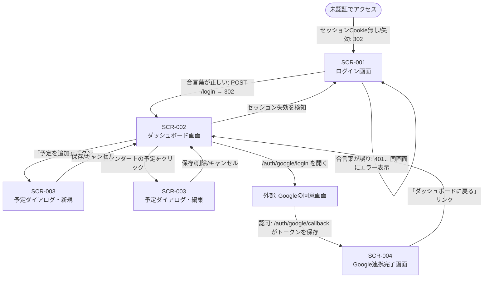

# 画面設計書(Personal Calendar)

各画面のレイアウトと、画面上でいつAPIを呼ぶかというイベント設計は、[画面レイアウト・イベント設計書](./screen-layout-event-design.md)に定義している。

## 実装状況

本書の4画面は、Next.js(TypeScript)のフロントエンド(`frontend/`)として実装済み。Goのバックエンドは画面を返さず、JSONを返すAPIと認証のエンドポイントだけを担当する。ブラウザは同一オリジン(Next.js)の `/api/*` を呼び、Next.jsの `rewrites` がGoへ転送する。

実装にあたって設計から変えた点は、本書の各項目に反映済み。変更の経緯は [設計からの変更点](#設計からの変更点) にまとめている。

## 画面一覧

| 画面ID | 画面名 | 画面の目的 | 主要な要素 | 関連するAPIエンドポイント |
|---|---|---|---|---|
| [SCR-001](#design-scr-001) | ログイン画面 | 合言葉を入力し、ダッシュボードへのアクセス権(セッションCookie)を得る | パスワード入力欄、ログインボタン、認証失敗時のエラーメッセージ | `POST /login` |
| [SCR-002](#design-scr-002) | ダッシュボード画面 | 会社カレンダー・天気・ToDoを1画面に統合表示し、各種操作の起点となるメイン画面 | ヘッダー(通知ボタン・予定追加ボタン・同期ボタン)、今日の天気ストリップ、ToDoリスト(入力欄・一覧・完了チェック・削除)、日/週/月の表示切替、カレンダー本体(時間軸グリッド)、予定ホバー時のポップオーバー(件名・時間・場所の簡易表示) | `POST /api/sync/google`、`GET /api/weather/today`、`GET /api/tasks`、`POST /api/tasks`、`PATCH /api/tasks/{id}`、`DELETE /api/tasks/{id}`、`GET /api/push/vapid-public-key`、`POST /api/push/subscribe`、`POST /api/push/unsubscribe` |
| [SCR-003](#design-scr-003) | 予定追加・編集ダイアログ | 新規予定の作成、または既存予定の件名・場所・日時の編集・削除・色分けカテゴリ設定を行う(ダッシュボード画面上のモーダルとして表示し、独立したページ遷移は発生させない想定) | 件名・場所・開始/終了日時の入力欄、色分けカテゴリ選択、場所からGoogleマップを開くリンク、削除ボタン(編集時のみ表示)、バリデーション/Google側エラーの表示欄 | `POST /api/events`、`PUT /api/events/{id}`、`DELETE /api/events/{id}`、`PUT /api/events/{id}/category` |
| [SCR-004](#design-scr-004) | Google連携完了画面 | Googleの同意画面から戻ってきた際に、カレンダー連携が完了したことを伝える簡易確認画面 | 連携完了メッセージ(連携したメールアドレスを表示)、ダッシュボードへ戻るリンク | なし(`GET /auth/google/callback`がトークン保存を終えたうえで、この画面へ転送してくる) |

各行の画面IDは、[設計判断](#設計判断)内の対応する項目にリンクしている。

### 画面として扱わない想定のもの(補足)

- **予定のポップオーバー**: カレンダー上の予定にマウスを重ねた際に件名・時間・場所を表示する小さな吹き出し。クリックやページ遷移を伴わないホバー専用のUI部品として設計するため、独立した画面ではなく[SCR-002](#design-scr-002)の要素として扱う
- **Googleの同意画面**: `GET /auth/google/login`のリダイレクト先。Google側が提供する画面であり、このアプリの画面設計の対象外(遷移図では「外部」として扱う)
- **プッシュ通知の許可ダイアログ**: ブラウザが表示するネイティブUIであり、このアプリで作り込む画面には含めない

## 画面遷移図

## 設計判断

### [SCR-003] 予定操作をページ遷移ではなくモーダルに留める
予定の追加・編集(SCR-003)は独立したページに分けず、ダッシュボード上のダイアログ(モーダル)として実装する方針にする。カレンダー全体の表示を保ったまま予定を操作できるようにする狙いで、ページ遷移によって「今どこを見ていたか」を見失わせないようにする判断をした。この結果、画面遷移図の上では「別画面への遷移」ではなく「同一画面内の状態変化」として表現している。

### [SCR-002 / SCR-004] Google連携をダッシュボードへの入り口から切り離す
Google連携(SCR-004に至る一連の流れ)は、通常のログイン動線(SCR-001→SCR-002)とは独立した、任意のタイミングで行う「管理者操作」として設計する。[api-db-design.md](api-db-design.md)の認証設計の通り、ビューア認証(合言葉)とGoogle認証(共有・1回のみ)を分離した方針を、画面遷移の構造にもそのまま反映させる。

連携を開始する`/auth/google/login`への導線は、ダッシュボードに常設していない。この操作は会社PCで初回に1回行えば済むうえ、個人のスマートフォンから実行してもGoogle側のポリシーで弾かれる。日常的に使う画面に、普段は押せないボタンを並べる利点が薄いと判断し、URLを直接開く運用としている。

### [SCR-001 / SCR-002] 未ログイン時の遷移先を一本化する
保護された画面(SCR-002)・APIのどちらにセッション切れの状態でアクセスしても、遷移先は常にSCR-001(ログイン画面)に統一する。画面ごとに異なるエラー画面を用意せず、「未認証なら常にログイン画面に戻す」というシンプルな規則にすることで、遷移パターンの数を増やさない判断をした。

この規則は2か所で担保している。画面を開く時点ではフロントエンドの`proxy.ts`がセッションCookieの有無を見てログイン画面へ転送し、画面を開いたあとのAPI呼び出しでは、Goが返す未認証時の転送をフロントエンドが検知してログイン画面へ移動させる。ただし認証の判断そのものはGo側が毎回DBと照合して行うものであり、フロントエンド側の確認は無駄な往復を減らすための前段に過ぎない。

### カバーしない操作パターン
- **ログアウト機能** ([SCR-001](#design-scr-001)/[SCR-002](#design-scr-002)): 明示的にセッションを破棄する画面・ボタンは設けない。合言葉が漏洩した場合の対処は「サーバー側で`APP_PASSWORD`を変更する」運用でのみ対応する想定とし、画面設計の対象からは外す
- **合言葉を忘れた場合の再発行フロー** ([SCR-001](#design-scr-001)): `APP_PASSWORD`は環境変数による固定値とする想定のため、アプリ内での再発行機能は設計しない
- **Google連携の解除画面** ([SCR-004](#design-scr-004)): 連携済みのGoogleアカウントを付け替える・解除する専用画面は設けず、再度`/auth/google/login`を実行してGoogle側で別アカウントを選び直すことで上書きする想定とする(明示的な「解除」操作は対象外)

## 設計からの変更点

実装(Step 6)の過程で、本書の内容を次の2点について更新した。

### SCR-004をフロントエンド側の画面にした
当初はGoogleのコールバックを受けたバックエンドが、そのままHTMLを返す想定だった。実装ではバックエンドを「JSONを返すAPI」に統一したため、コールバック処理(トークンの交換・アカウントの確認・保存)を終えたあと、連携したメールアドレスを添えてフロントエンドの画面へ転送する形に変えた。画面の実体が1か所にまとまり、バックエンドがHTMLを組み立てる処理も無くなった。

### 未ログイン時の検知を2段構えにした
当初は「画面を開いた時点でバックエンドが判定する」ことだけを想定していた。画面を返すのがフロントエンドになったため、画面を開く時点の確認はフロントエンド側で行い、画面を開いたあとのAPI呼び出しについては、バックエンドの応答から未認証を検知してログイン画面へ移動させる形にした。遷移先が常にSCR-001である点は変えていない。

## まとめ

### 設計中に苦労したこと・判断に迷ったこと
特にありませんでした。

### 学んだこと
- 画面遷移図は「実装上のファイル・URLの単位」ではなく、「ユーザーから見た操作のまとまり」を基準に描くべきだと実感した。今回のダッシュボードのように、URLとしては1つでも、ユーザー体験としては複数の目的(カレンダーの閲覧・予定の編集・ToDoの管理)が同居する場合、後者の基準で画面を切り出す方が、後から見返した際に迷いにくい設計書になる。実際、実装では予定ダイアログ(SCR-003)が独立したファイルになっており、設計書の切り分けがそのままコードの構造に対応した
- API仕様書(Step 2)の時点でエンドポイントを「画面・認証」と「API」に分けて整理していたことが、今回の画面一覧作成の土台としてそのまま活きた。API設計と画面設計は別工程ではあるが、エンドポイント単位の整理が先にあると、画面ごとの「関連するAPI」の洗い出しが機械的に進められる
